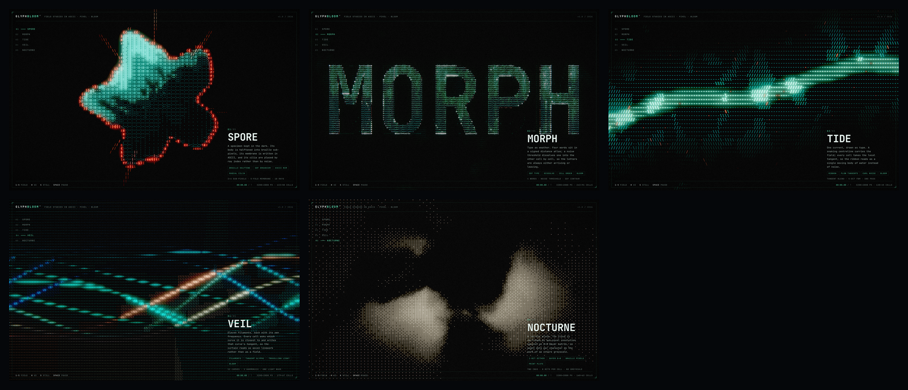

# GLYPHBLOOM

Field studies in **ASCII × pixel × bloom** — five generative posters built from a
character grid, a glyph atlas, and one HDR bloom chain. Everything is WebGL2,
no dependencies, no build step.

**Live:** https://swanlepeltier.github.io/glyphbloom/



```
open  http://localhost:8899            # python3 -m http.server 8899 in this folder
```

Keys: `1–5` switch field · `H` hides the UI · `S` saves a PNG · `SPACE` pauses.
URL overrides: `?scene=spore&t=12&ui=0` (deterministic frame, good for capture).

## The five fields

| # | Field | Idea | Technique |
|---|-------|------|-----------|
| 01 | **SPORE** | a specimen kept in the dark | SDF organism, braille-halftoned interior (2×4 sub-pixels against a 4×4 Bayer matrix), ASCII membrane, ray-indexed cilia |
| 02 | **MORPH** | type as weather | four words baked to a signed-distance atlas, dissolved one into the next cell by cell with a noise threshold |
| 03 | **TIDE** | one current, drawn as type | curl-noise flow field, every cell takes the local tangent → directional glyphs |
| 04 | **VEIL** | a curtain of filaments | 11 harmonic curves, each cell picks its nearest curve and writes its slope |
| 05 | **NOCTURNE** | a one-bit plate | braille sub-pixels against an 8×8 Bayer matrix, two inks, no greyscale |

## How it renders

Three passes, and the first one is the whole trick:

1. **Cell pass** — draws into a `cols × rows` target, one fragment per character.
   Output is `vec4(colour.rgb, glyphIndex)`. All the expensive work (fbm, SDF,
   8 braille probes) happens once per character, not once per pixel.
2. **Glyph pass** — full resolution. Reads the cell target with `NEAREST`,
   decodes the index from alpha, samples the glyph atlas mask, writes
   `colour × mask`. The atlas is built once at boot: a density ramp sorted by
   *measured ink*, a 4-way direction set, a dot ramp, blocks, and 256 braille
   patterns drawn procedurally with canvas arcs (font-independent, pixel-exact).
3. **Finishing** — soft-knee threshold → 6 downsample mips → upsample-add →
   ACES-style tonemap → chromatic aberration, grain, vignette, scanlines,
   aperture mask.

Grid geometry: `rows = H / (cell × dpr)`, `cols = W / (cellH × 0.6)` — monospace
cells are 0.6 as wide as tall, so glyphs never stretch.

Per-field tuning lives in the scene module (`src/scenes/*.js`): `cell` (character
size in CSS px), `post` (bloom/exposure/CA/grain/scanline/mask), `frag` (the cell
shader), optional `uniforms()` / `textures()`.

## Capture

`tools/capture.py` drives `window.__render(t)` in headless Chromium, so a frame
is a pure function of time — no rAF, no accumulated state, reproducible output.

```bash
# still, 1600×1000 CSS at 2× device pixels
python tools/capture.py --scene spore --t 14 --out output/spore.png --ui 0

# a 6 s loop at 20 fps, then encode
python tools/capture.py --scene tide --frames 120 --duration 6 --out frames/tide \
    --w 1280 --h 800 --scale 1.5
ffmpeg -framerate 20 -i frames/tide/%05d.png -vf scale=1280:-2 \
    -c:v libx264 -pix_fmt yuv420p -crf 24 output/loop-tide.mp4
```

Rendering cost, on this box: one 3200×2000 still ≈ 8 s, one 1280×800 frame ≈
0.4 s (a 120-frame loop ≈ 4 min).

## Files

```
index.html            app shell + poster frame
src/style.css         the typographic system (JetBrains Mono, 1 border, 2 corner marks)
src/main.js           scene registry, passes, deterministic render API
src/gl.js             programs, render targets, uniform binding
src/atlas.js          glyph atlas (ramp sorted by measured ink, procedural braille)
src/glyph.js          display pass
src/post.js           bloom chain + composite, GLSL library (noise, fbm, curl, smin, aces)
src/words.js          word → ink bbox → signed distance atlas (8SSEDT)
src/scenes/*.js       the five fields
tools/capture.py      deterministic Playwright capture
output/final/web/      the same plates/posters/contact sheet, web sizes (tracked)
```

### What the repo tracks

`output/final/web/` (…–2.4 MB), the two MP4 loops, the spore GIF and the contact
sheet are committed so the posters are visible without rendering anything. The
full-resolution 3200×2000 originals, the 240 intermediate capture frames in
`frames/` and every debug screenshot under `output/` are gitignored — they are
reproducible with `tools/capture.py` and would otherwise add ~1.2 GB of binaries.

## Notes / limits

- WebGL2 required; falls back to an error overlay with the shader log.
- The poster frame is HTML, not part of the shader: `--ui 0` gives the clean plate.
- Frames are seeded by time only, so any `t` reproduces exactly; there is no
  simulation state to warm up.

## License

MIT — see [LICENSE](LICENSE).
